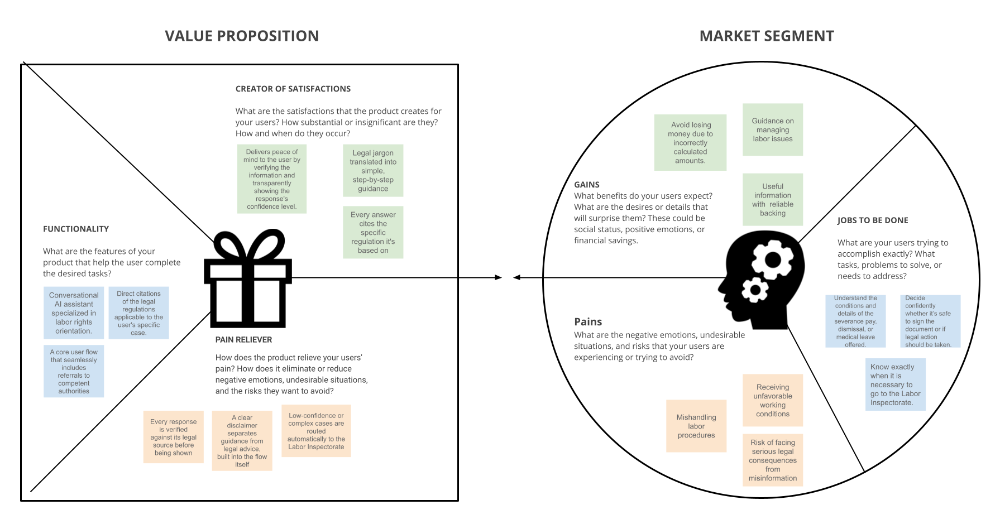
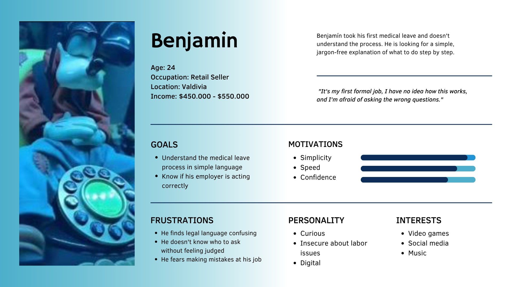
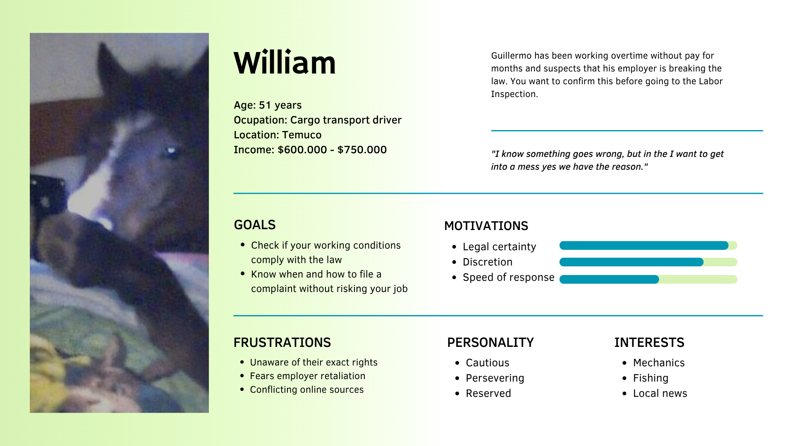
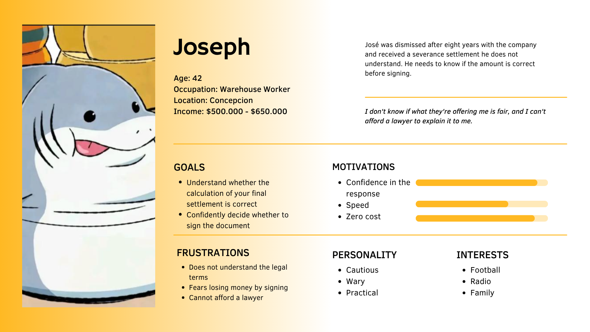
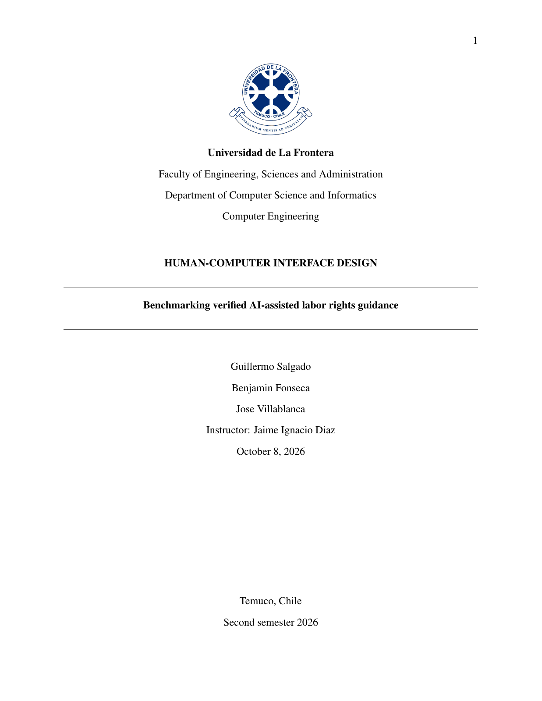
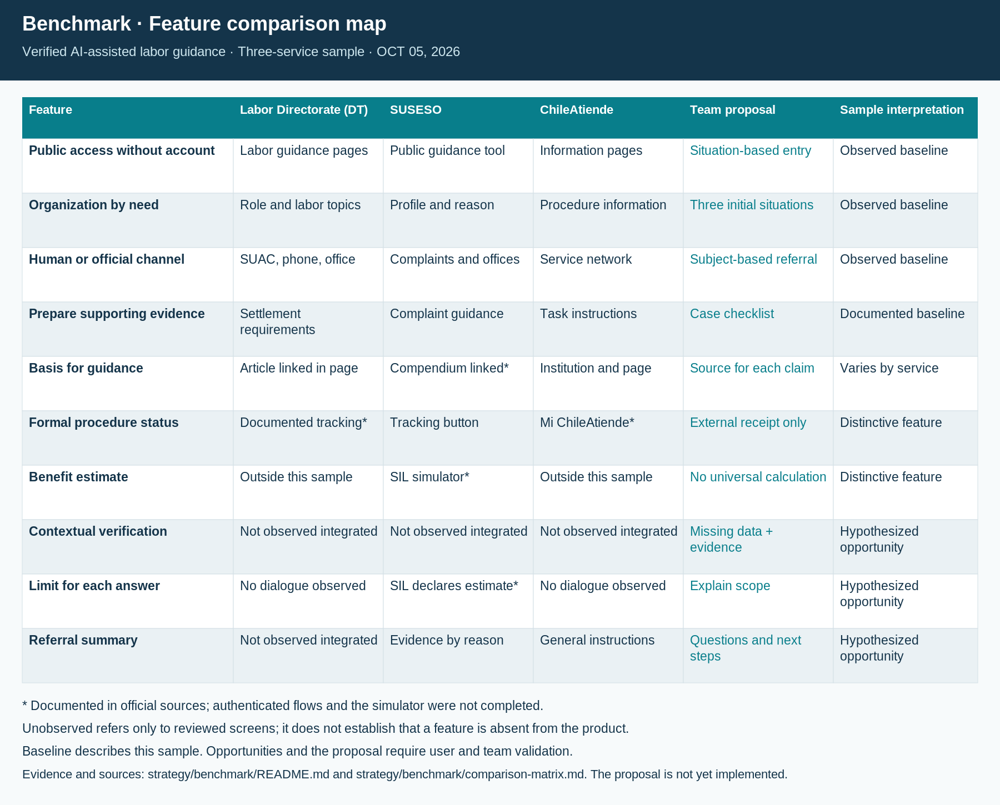
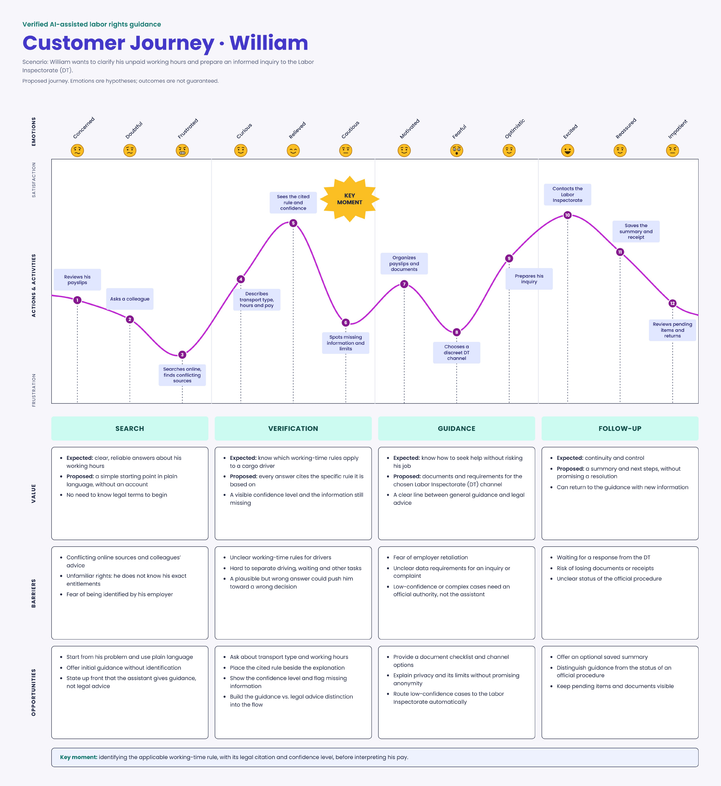
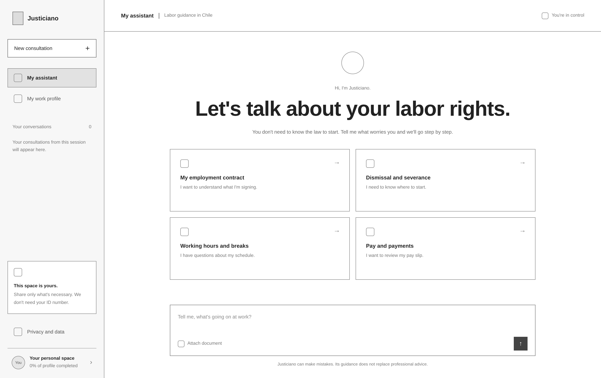

# Justiciano UXD

User experience design process for Justiciano: verified AI-assisted labor rights guidance, developed for the Human-Computer Interface Design course at the University of La Frontera (UFRO), Temuco, Chile.

## Index

1. [Introduction](#1-introduction)
   - [1.1. The Problem](#11-the-problem)
   - [1.2. Our Solution](#12-our-solution)
2. [Team & Roles](#2-team--roles)
3. [Strategy](#3-strategy)
   - [3.1. Value Proposition Canvas](#31-value-proposition-canvas)
   - [3.2. UX Personas](#32-ux-personas)
   - [3.3. Benchmarking](#33-benchmarking)
4. [Scope](#4-scope)
   - [4.1. Customer Journey Map](#41-customer-journey-map)
5. [Skeleton](#5-skeleton)
   - [5.1. Low-Fi Wireframes](#51-low-fi-wireframes)
6. [Annex](#6-annex)

## 1. Introduction

### 1.1. The Problem

**Initiative 16: Verified AI-assisted labor rights guidance** addresses a trust problem. Conversational AI may give plausible but incorrect answers about dismissals, severance settlements, or medical leave, and acting on them can have legal consequences. The course classifies this initiative in the **labor** domain with **high UX complexity**.

The representative scenario is a worker who receives a severance settlement they do not understand and needs to decide whether to sign it or seek help. Read the [project brief](docs/project-brief.md) for the translated assignment context, design requirements, and selected problem.

### 1.2. Our Solution

**Justiciano** is an assistant concept that explains labor rights in plain language, cites the applicable rules, communicates uncertainty and its own limits, and guides people to the Labor Inspectorate when their case requires official assistance. Workers can start from a topic or a free-text question without creating a profile or sharing an ID number.

The assistant is a design concept: this repository documents the process and its low-fidelity wireframes, and nothing is implemented yet.

## 2. Team & Roles

| Role | Name |
| --- | --- |
| Instructor | Jaime Ignacio Diaz |
| Team leader | Guillermo Salgado |
| Team member | Benjamin Fonseca |
| Team member | Jose Villablanca |

## 3. Strategy

Deliverables are in [`strategy/`](strategy/).

### 3.1. Value Proposition Canvas

We mapped workers' jobs, pains, and desired gains to the product's proposed features, pain relievers, and benefits. The canvas links needs such as understanding a settlement, handling medical leave, and knowing when to contact the Labor Inspectorate to plain-language guidance, legal citations, visible confidence levels, and referral to the competent authority.



### 3.2. UX Personas

We created three personas to describe distinct labor rights situations and the information each worker needs. Their goals and frustrations frame the language, trust cues, and referral paths the interface must support.

| Persona | Situation | Main need |
| --- | --- | --- |
| Benjamin | A retail worker navigating his first medical leave | Simple, step-by-step guidance without legal jargon |
| William | A cargo transport driver checking unpaid overtime | Reliable information and a discreet route to a complaint |
| Joseph | A warehouse worker reviewing a severance settlement after dismissal | Understand the calculation before deciding whether to sign |

#### Benjamin



#### William



#### Joseph



### 3.3. Benchmarking

We compared Dirección del Trabajo (DT), SUSESO, and ChileAtiende to identify useful patterns for understandable, verifiable labor rights guidance. The study covers fourteen dimensions and nine annotated public screenshots observed on October 5, 2026. It distinguishes observed features, documented capabilities, and design hypotheses for the proposed product.

The [full benchmarking report](strategy/benchmark/benchmark.pdf) follows APA 7 for the body, citations, and references, with an adapted UFRO institutional cover. Read the [analysis](strategy/benchmark/README.md), [comparison matrix](strategy/benchmark/tabla-comparativa.md), or [editable LaTeX sources](strategy/benchmark/latex/README.md).

[](strategy/benchmark/benchmark.pdf)



## 4. Scope

Deliverables are in [`scope/`](scope/).

### 4.1. Customer Journey Map

We mapped William's journey from noticing potentially unpaid hours to preparing a consultation with the Labor Directorate. The definitive map contains twelve actions across Search, Verification, Guidance, and Follow-up, with an emotional curve, value, barriers, and opportunities. The proposed journey and emotions are hypotheses to validate; outcomes are not guaranteed.

[View the definitive Customer Journey PDF](scope/customer-journey/Customer%20Journey%20%C2%B7%20William.pdf) or read its [brief explanation](scope/customer-journey/README.md).

[](scope/customer-journey/Customer%20Journey%20%C2%B7%20William.pdf)

## 5. Skeleton

Deliverables are in [`skeleton/`](skeleton/).

### 5.1. Low-Fi Wireframes

The main view is **My assistant**, where a worker starts a consultation from one of four topics or from a free-text question. The permanent notice under the input states that Justiciano can make mistakes and does not replace professional advice.



The remaining views are available in the [wireframes directory](skeleton/wireframes/README.md):

- [Conversation](skeleton/wireframes/README.md#conversation): a consultation with a cited answer.
- [Onboarding](skeleton/wireframes/README.md#onboarding): the public page that introduces the service.
- [My work profile](skeleton/wireframes/README.md#my-work-profile): optional context about the worker's job.
- [Privacy and data](skeleton/wireframes/README.md#privacy-and-data): what is shared and how to control it.

## 6. Annex

Supporting material is in [`annex/`](annex/): the [research notes](annex/research_notes/), the [benchmarking report in Markdown](annex/reports/), and the [activity verification](annex/verificacion-actividades.md). The [project brief](docs/project-brief.md) and the [scripts that reproduce the generated artifacts](scripts/README.md) are available in `docs/` and `scripts/`.

## Repository contents

```text
.
├── README.md
├── docs/            # Project brief
├── strategy/        # Value proposition, UX personas, benchmarking
├── scope/           # Customer journey
├── skeleton/        # Low-fidelity wireframes
├── annex/           # Research notes, reports, activity verification
└── scripts/         # Reproducible artifact generators
```

The course handouts are kept locally and are not versioned.
