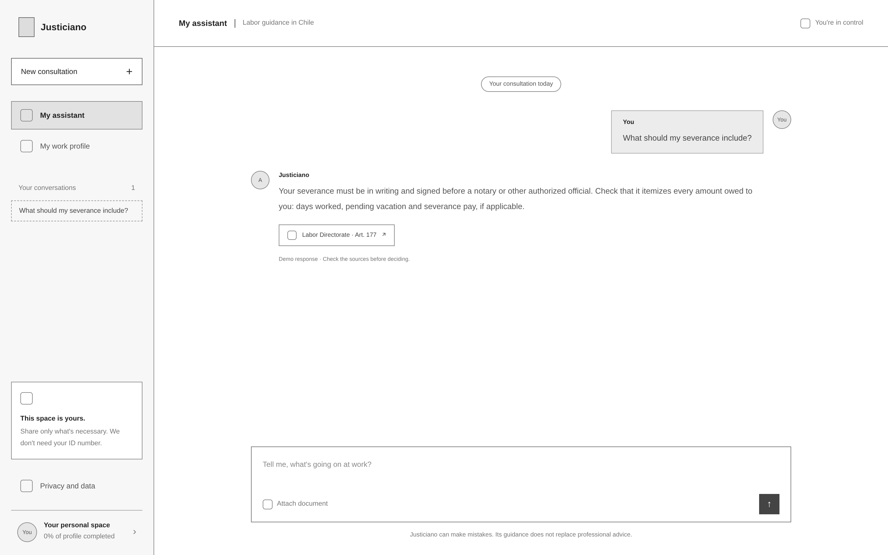
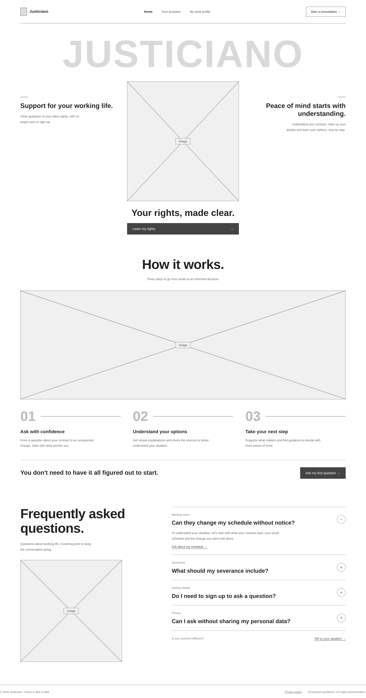
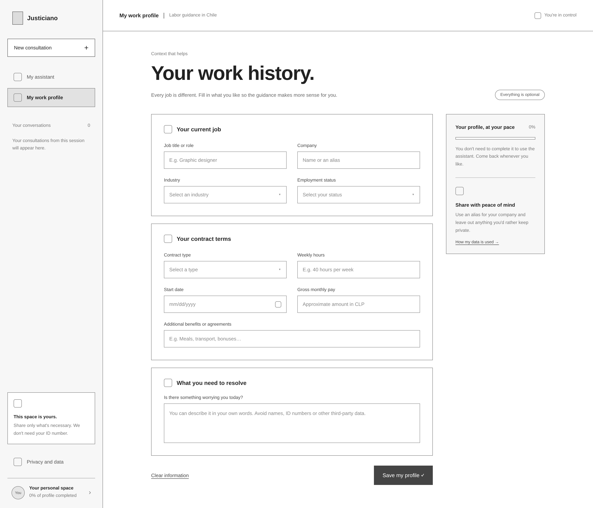
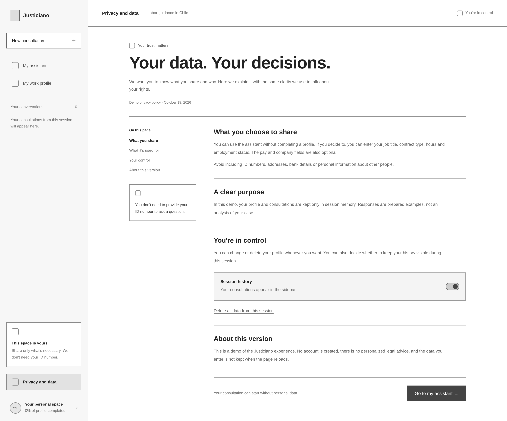

# Low-fidelity wireframes: Justiciano

Main views of **Justiciano**, the verified AI-assisted labor rights guidance concept. The wireframes are grayscale and low fidelity: boxes mark icons and images, and all copy is placeholder content. The app views share one layout, with a persistent sidebar, a header and a main area. Nothing shown here is implemented.

| View | File | Purpose |
| --- | --- | --- |
| [My assistant](#my-assistant) | [`assistant.png`](assistant.png) | Main screen: start a consultation from a topic or a free-text question. |
| [Conversation](#conversation) | [`chat.png`](chat.png) | A consultation with a cited answer. |
| [Onboarding](#onboarding) | [`onboarding.png`](onboarding.png) | Public landing page that explains the service before the first question. |
| [My work profile](#my-work-profile) | [`profile.png`](profile.png) | Optional work context to make guidance more relevant. |
| [Privacy and data](#privacy-and-data) | [`privacy-policy.png`](privacy-policy.png) | What is shared, why, and how to control it. |

## My assistant

The first screen after onboarding. The headline invites the worker to talk about their labor rights, and four topic cards (employment contract, dismissal and severance, working hours and breaks, pay and payments) offer a starting point for people who do not know how to phrase a question. A free-text field with an **Attach document** action sits at the bottom, and a permanent notice states that Justiciano can make mistakes and does not replace professional advice.

The sidebar carries the product's recurring elements: **New consultation**, navigation to the assistant and the work profile, the list of conversations in the session, a reminder that the space is private and no ID number is needed, a link to **Privacy and data**, and the profile completion level. The header repeats a **You're in control** cue.

## Conversation

A consultation in progress. The assistant's answer is followed by a source chip (**Labor Directorate · Art. 177**) that opens the cited rule, and a note marks the answer as a demo response and asks the worker to check the sources before deciding. The conversation is added to the sidebar list.

## Onboarding

A public page for first-time visitors, with a **Start a consultation** call to action in the header. It states the value in plain language, explains the service in three steps (ask with confidence, understand your options, take your next step), answers frequently asked questions about schedule changes, severance, sign-up, and privacy, and closes with a footer that links the privacy policy and states that the guidance is not legal representation.

## My work profile

An optional form that gives the assistant context. Fields are grouped into the current job, contract terms, and what the worker needs to resolve. A badge states that everything is optional, a side panel shows progress and explains that the assistant works without completing the profile, and recommends using an alias for the company. Workers can **Clear information** or **Save my profile**.

## Privacy and data

A plain-language privacy page organized around what the worker chooses to share, the purpose of the data, the controls they have, and the status of this version. It includes a session history switch and an action to delete all session data, and it ends with a shortcut back to the assistant.

