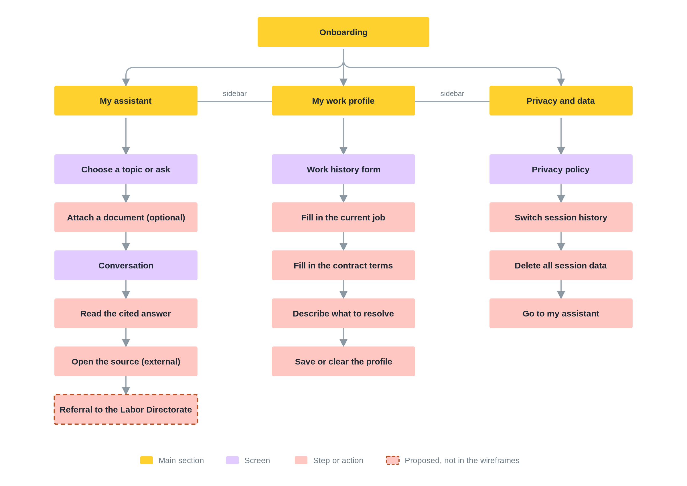

# Navigation flow

Structure of **Justiciano**, drawn from the [low-fidelity wireframes](../skeleton/wireframes/README.md). The diagram shows how the screens connect and which steps each section contains. It is a proposal for the team to validate, not a tested flow.

The [SVG version](navigation-flow.svg) scales without loss.

## How to read it

| Color | Meaning |
| --- | --- |
| Yellow | The onboarding page and the three main sections of the app. |
| Purple | A screen. |
| Pink | A step or action inside a screen. |
| Pink with a dashed border | Proposed. It is not in any wireframe. |

The line between the three sections is the sidebar, which links them on every app screen. Each chain reads from top to bottom in the order the wireframes suggest.

| Section | Wireframe |
| --- | --- |
| Onboarding | [`onboarding.png`](../skeleton/wireframes/onboarding.png) |
| My assistant | [`assistant.png`](../skeleton/wireframes/assistant.png) and [`chat.png`](../skeleton/wireframes/chat.png) |
| My work profile | [`profile.png`](../skeleton/wireframes/profile.png) |
| Privacy and data | [`privacy-policy.png`](../skeleton/wireframes/privacy-policy.png) |

## Open points

- **Referral.** The conversation ends at the cited answer. The dashed step marks where the brief expects the referral to the Labor Directorate. No wireframe covers it yet.
- **Medical leave.** The assistant offers four topics and none is medical leave, so Benjamin's scenario has no visible entry point.
- **Names.** The landing page says *Your assistant* and *Start a consultation*, while the app says *My assistant* and *New consultation*.
- **Assumed destinations.** The wireframes show the header cue *You're in control* and the sidebar item *Your personal space* without a destination. This diagram does not draw them.

## Regenerate

The diagram is generated by [`scripts/generate_structure.py`](../scripts/README.md#navigation-flow).
